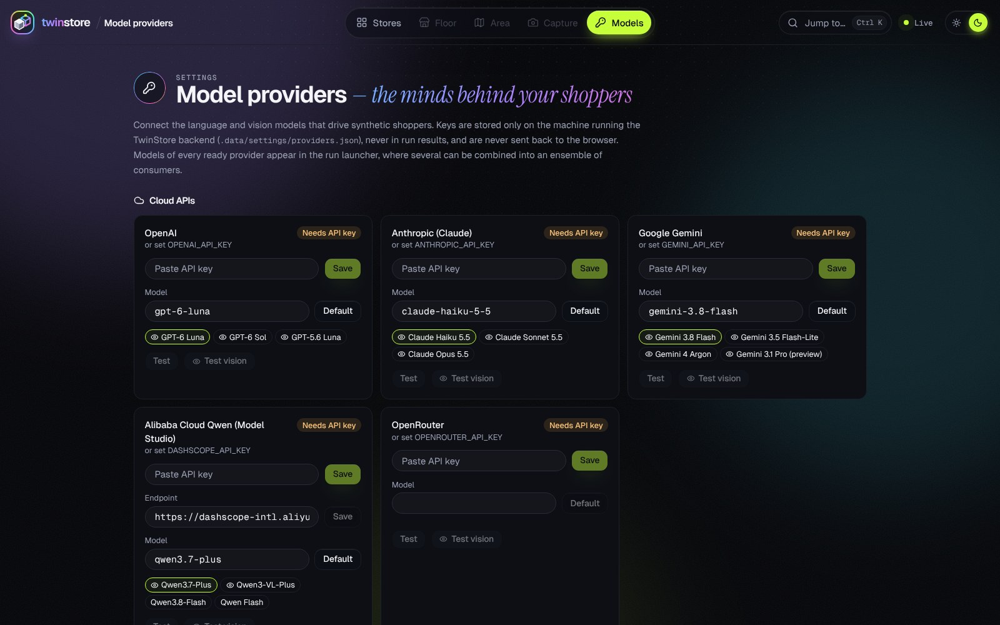

<div align="center">

<a href="./.github/assets/twinstore/twinstore-promo.mp4"></a>

<h1>TwinStore</h1>

<p><b>The digital twin of your store, shopped by synthetic customers who can see.</b><br>
Rebuild a store from photos and plans, fill it with vision-language shoppers, and test every layout,<br>
price and promotion on the same people — before you move a shelf.</p>

<p>
<a href="https://github.com/BrainJellyPie/parastore/releases/latest"></a>
<a href="./LICENSE"></a>
<a href="./.github/assets/twinstore/twinstore-promo.mp4"></a>
</p>

<p>
<a href="#one-icon-every-os">Start</a> ·
<a href="#watch-it-run">Watch</a> ·
<a href="#what-you-can-do">Features</a> ·
<a href="#how-it-works">How it works</a> ·
<a href="#validated-on-real-baskets">Validation</a> ·
<a href="#for-researchers">Research</a> ·
<a href="#for-developers">Developers</a> ·
<a href="#license">License</a> ·
<a href="./QUICKSTART.md">한국어 빠른 시작</a>
</p>

<sub>TwinStore is built on <a href="https://github.com/intellicia-public/parastore">Parastore</a> by intellicia, released under the MIT License.</sub>

</div>

---

## Why TwinStore

- **A twin, not a mock-up.** Shelf photos become planograms, floor-plan sketches become the store grid, receipts and
  POS exports score the simulation, storefront photos set how many people walk in.
- **Shoppers that look.** Vision-language models see the shelf the shopper would see — a photoreal render or the real
  photo — read prices and promotion signs, and say what tempts them. Purchases are seeded draws, so two layouts are
  always compared on the very same people.
- **Answers with error bars.** Paired A/B runs with confidence intervals, a layout optimizer judged by vision shoppers,
  compliance audits priced in revenue per day, and a validation loop against real households' baskets.

## One icon, every OS

Download the archive for your computer from **[Releases](https://github.com/BrainJellyPie/parastore/releases/latest)**,
unpack it and double-click the **TwinStore** icon. The browser opens a boot screen with live progress and switches to the
app when it is ready. Nothing to install beforehand — the first start fetches Python and the packages (a few minutes,
once); later starts take seconds.

<table>
<tr>
<td width="56%"></td>
<td>

| Computer | Download | Double-click |
| :-- | :-- | :-- |
| Windows 10/11 | `…-windows-x64.zip` | **TwinStore.exe** |
| macOS 11+ | `…-macos.zip` | **TwinStore.app** |
| Linux x64 / arm64 | `…-linux-*.tar.gz` | **twinstore** |

Clicking the icon again reopens the running app. Quit with
<kbd>⌘K</kbd> / <kbd>Ctrl K</kbd> → **Quit TwinStore**.
First-time security prompts and details: [`QUICKSTART.md`](./QUICKSTART.md).

</td>
</tr>
</table>

No API key is needed to start: the sample store runs with the rule-based engine. Add an OpenAI, Anthropic, Gemini or Qwen
key — or a local vLLM / Ollama / llama.cpp server — under **Models** for language and vision shoppers.

## Watch it run

<table>
<tr>
<td width="50%"><a href="./.github/assets/twinstore/twinstore-promo.mp4"></a><br>
<b>The film</b> · 49 s · what TwinStore is, in motion (<a href="./.github/assets/twinstore/twinstore-promo.mp4">MP4</a>)</td>
<td width="50%"><a href="./.github/assets/twinstore/twinstore-demo.mp4"></a><br>
<b>The app, running</b> · 67 s real recording: ⌘K palette, 3D playback, heatmap, shopper's eye, Shelf Lab, neighborhood, night theme (<a href="./.github/assets/twinstore/twinstore-demo.mp4">MP4</a>)</td>
</tr>
</table>

## What you can do

<table>
<tr>
<td width="50%"><br>
<b>Photoreal 3D twin.</b> Shoppers walk the floor on a wall-clock day; scrub, pause, speed up, follow anyone. <b>Photo</b> path-traces any view into a still.</td>
<td width="50%"><br>
<b>Shopper's-eye view.</b> The first-person camera shows what a shopper — and the vision model — sees.</td>
</tr>
<tr>
<td><br>
<b>Heat, dwell and traffic.</b> Footfall, dwell and predicted-traffic layers, rack KPIs in 3D, revenue by rack.</td>
<td><br>
<b>Shelf capture &amp; Shelf Lab.</b> A phone photo becomes a planogram; edit it counterfactually and audit it.</td>
</tr>
<tr>
<td><br>
<b>The neighborhood.</b> Huff demand, rival stores, synergy with the shop next door, storefront appeal.</td>
<td><br>
<b>New store in two steps.</b> Store details, an address, opening hours — or start from a floor-plan image.</td>
</tr>
<tr>
<td><br>
<b>A/B tests for marketers.</b> Price, discount, promotion sign, placement or a new pack, on the same shoppers; lifts with 95 % CIs.</td>
<td><br>
<b>Concept tests.</b> Drop pack images; personas rate intent, appeal, value, price range and preference.</td>
</tr>
<tr>
<td><br>
<b>Follow one shopper, then ask why.</b> Their path, stops and thoughts step by step; interview them afterwards, alone or as a group.</td>
<td><br>
<b>Price sweeps.</b> A product at five prices on the same shoppers: demand curve, elasticity, revenue-maximising price.</td>
</tr>
<tr>
<td><br>
<b>Day and night.</b> A command bar, <kbd>⌘K</kbd> palette for everything, light and dark themes.</td>
<td><br>
<b>Any model.</b> Cloud APIs or local servers, text and vision, single models or ensembles.</td>
</tr>
</table>

### Generate a store layout

The **New store** wizard can start with a furnished template or an empty layout.
The initial layout uses your store name, type and opening hours, and is ready to
edit as soon as the project is created. Persona generation follows the existing
wizard flow; choosing a template does not make an LLM layout-generation call.

In a project, choose **New layout → Generate a store from a template**. Search 36
formats including hypermarkets, warehouse clubs, pharmacies, cafés, restaurants,
fashion boutiques, bookstores, electronics, pet supplies and design showrooms.
Each format includes its own generic product assortment.

Restaurant and café starting points include a family restaurant, neighborhood
bistro, takeaway coffee kiosk, tea lounge and artisan bakery. Vintage boutiques,
hardware stores and toy/hobby shops add distinct assortments and interior defaults.
Formats can supply their own seating zone, checkout placement and palette; every
default can be adjusted before saving. Multi-floor starting points also include a
family shopping center and a vintage shop with an upstairs tea lounge.

USD, KRW and JPY prices keep their currency with the saved layout and simulation
results. New-project shopper budgets use the chosen currency, and additional
layouts default to that project currency. Existing shopper budgets are not
converted when a different template currency is chosen; use matching currency
for a simulation, or start a separate project for that market.

Combine six patterns (parallel aisles, racetrack, central spine, free-flow islands,
open-center perimeter and showroom groups) with a custom grid up to 40×40 cells,
three display densities, left/center/right entry, one to four checkouts and shelf
variants. Six saved interior palettes—classic retail, warm wood, minimal white,
industrial graphite, botanical sage and charcoal/brass—change walls, shelving,
counters and floor tint in Realistic view and Photo mode. Formats choose a suitable
default palette; each building floor can use a different one. The preview uses the same options as the saved layout. Shuffle changes
the assortment reproducibly; reset restores the format's layout defaults.
Additional design briefs are saved as editable notes, not interpreted as commands.

Interior shelf rows can run left to right or front to back. This rotates the
interior pattern and its product-facing sides while keeping the entrance,
checkouts, wall fixtures, seating and reserved areas in their chosen locations.
The perimeter pattern keeps its wall-based arrangement. Shelf direction is saved
with the other options and can differ between floors or layout alternatives.

Use **Keep areas clear → Add reserved area** to leave up to eight named rectangles
open for consultation, pickup, events or later customization. Set their starting
column and row (counting from 1 at the back-left corner), width and depth. Areas
must fit inside the outer wall cells, where the template keeps its doors and wall
fixtures. The preview marks reserved space with dashed outlines; generated shelves
and tables avoid it. Default seating adapts to the remaining space; an explicit
table count that no longer fits returns an adjustment message. Areas remain
walkable and do not add rooms or service behavior. Settings are saved and restored
for single layouts and building floors; subsequent manual floor edits can use the
space freely.

To iterate on a generated layout, open **New layout → Generate a store from a
template → Reuse options from …**. This restores its format, dimensions, style,
seating, currency, seed and design brief. Save a changed version as a linked
alternative while preserving the source; floor alternatives keep their building
identity. Use the import option to copy manual fixture edits or uploaded products.

Add up to 12 dining tables (four chairs each) to any format. Café and restaurant
defaults include seating; small grids reduce the default count to fit. An explicit
count that cannot fit returns a capacity message. Each group occupies 2×2 cells
with clear circulation around it, appears in Classic and Realistic views, and can
be selected from any of its four cells in the floor editor. As with other fixtures,
the existing floor-edit unlock step clears product placements before editing.

Choose where seating starts: front/entrance side, back wall, left, right or center.
Tables extend into neighboring space as their count increases, retaining their
circulation space. Checkout counters can use the default arrangement or be placed
near or away from the entrance. These choices appear in the preview and are saved
per layout or building floor, including when reusing settings for an alternative.

The floor editor supports up to 40×40 cells, with zoom controls and a scrollable
grid that keeps fixtures readable on large floors and smaller screens. Width and
depth can be typed directly. Reducing the grid never deletes fixtures silently;
save reports fixtures outside the new bounds so you can adjust the floor first.
Select a shelf, counter, dining group or gate and use the move arrows to shift it
one cell at a time. The full footprint must fit in clear space; paired entrances
and exits move together. Names, designs and rotation stay with the fixture.
For longer moves, choose **Move to a cell** and click the new top-left position
on the grid. Occupied or out-of-bounds targets leave the fixture in place so you
can pick another location; **Cancel placement** or Escape cancels the move.

Choose **Multi-floor store** to create 2–6 linked layouts in one operation. Start
with a department store, shop with upstairs café, pharmacy/wellness building or
restaurant/café, then select each floor to change its format and options. Floor
labels appear in the layout tabs. Each floor has its own simulation; cross-floor
travel, stairs, lifts and a combined building simulation are not modeled.

For an existing generated building, **Reuse building options from …** restores
the selected floor and the newest saved version of each other floor. Select a
different saved floor version, move floors higher or lower, duplicate a floor,
and change its options before saving a separate building. Each new floor records
its source layout; the original building stays unchanged.

Use **Find layout** beside the layout tabs to search saved alternatives by name,
building, floor, store format or design brief. Filter single floors or building
floors and switch directly to a result; the current layout appears first.

Grid cells are not measured square meters. Pharmacy templates cover retail OTC
care and wellness, not prescription dispensing. Café/restaurant templates model
counter purchases; tables reserve floor space but table service, dining time and
kitchen operations are not simulated.

## How it works


**Fig. 1 — System.** Photos, plans and sales data are turned into one JSON world per layout (store graph, personas,
situations, neighborhood, renderer, photo layer). Rule-based, LLM and VLM shoppers walk it on seeded days; results flow
back into calibration against real POS data.


**Fig. 2 — Vision shopper.** At the door the model reads a directory map and today's situation and writes a plan
(`EntryDecision`); at each shelf it sees the face — rendered or photographed, with numbered tags — and rates the most
tempting product 0–10 (`ShelfGlance`). The purchase is a seeded draw from that rating, so a model's eagerness cannot set
the purchase rate, and paired layouts share every random number.


**Fig. 3 — Shelf Lab.** Swap products, empty a run, inpaint a new package, reprint a price tag or hang a promotion on a
real shelf photo. Only pixels inside the changed boxes move, so every edit has an exact mask. The same shoppers judge
the render, the tagged photo and the raw photo (sim2real agreement with CIs), and compliance gaps against the reference
layout are priced in revenue per day by paired simulation. The shelf here is a photoreal render from the built-in
shelf studio, which supplies exact boxes; phone photos are edited the same way. Details: [`SHELF_LAB.md`](./SHELF_LAB.md).

### Photos in, twin out

| Input | What TwinStore does with it |
| :-- | :-- |
| Shelf photo | detects shelves and facings, reads names and price tags → a rack face in the planogram |
| Floor-plan image or multi-page PDF | preview the selected page and rotation → ink mask or vision model → walls, racks, doors on an 8–16 tile grid; PDF support included |
| Storefront photo | a vision model rates sign, entrance, window and upkeep → the venue's pull in the neighborhood model |
| Receipt photos | transcribed by a vision model → review product matches, quantities and paid amounts → check and score a run against corrected POS lines |
| Anonymous track CSV | device-extracted grid coordinates → observed vs simulated visitor and occupancy heatmaps, tracking-gap accounting and per-cell differences; aggregate reports only |
| Rival's shelf photo | price index and assortment overlap against your layout → the rival's price-adjusted pull |

### Marketing studio

For brand managers, category teams and research agencies (**Market** in the command bar):

- **Product library** — drop packshots or phone photos of packs (the background is cut out), name them, tag the brand
  and link each to the shelf product it replaces. Shelf Lab and the vision shoppers use the same images.
- **A/B tests** — a variant is a list of changes to a saved layout: a new price, a discount with the was-price on the
  tag, a promotion sign (1+1, SALE, −30 %), a move to eye level or another fixture, a new pack, or a category re-price
  with .99 endings. One-click recipes: discount ladder, discount vs sign, eye level vs bottom shelf, **price sweep**
  (a demand curve with the product's elasticity and revenue-maximising price), price up, new pack.
  Every arm runs on the **same shoppers with the same random numbers** as the control, so the result reports paired
  differences with bootstrap 95 % intervals — revenue, conversion and units per visitor, and units, spend and buyers of
  each tracked product — and names a winner only when its interval clears zero. Rule shoppers answer in seconds;
  vision shoppers also see packs and signs. Every finished test comes with a **report** — summary and
  recommendation, design, charts, tracked products, method — as a print-ready page (PDF) or Markdown.
- **Shelf tests** — the classic shelf impact test: the same respondents see the shelf as it is and with a new pack,
  price or sign (previewed live), pick what they would take and say what caught their eye first; pick share and
  stand-out are compared pair by pair.
- **Concept tests** — up to four images side by side; a vision model answers as each sampled persona (with age and
  gender quotas): purchase intent, pack appeal, value, stand-out (1–5), a Van Westendorp price range, preference and
  one open answer. Results show distributions, means with CIs, top-2-box, Wilson intervals for preference, the price
  curves with the acceptable range, segment tables and verbatims; respondent-level CSV export.
- **Staff scripts** — compare two exact greetings, recommendations or objection-handling lines on the same
  synthetic shoppers, with independent exposures and balanced request order. Hold the product, price and encounter
  context fixed; compare purchase intent, trust and pressure (1–5), paired bootstrap intervals, exploratory segments
  and customer replies. Save the stimuli and persona sample and export paired answers, including failures. Results
  screen wording for a field pilot; they do not estimate real conversion or sales. Needs a configured text model.
- **Observed field pilots** — turn a saved staff-script test into a fixed, balanced A/B assignment sheet within
  anonymous staff/shift blocks. Import actual encounter, delivery and target-product purchase records; retain
  refusals in their assigned arm and keep unknown outcomes distinct from nonbuyers. Close collection to lock the
  records. A complete planned sample receives a conservative 95% conversion-difference interval; early closure
  stays descriptive. The Field pilots tab keeps these records accessible independently of the synthetic test.
  Before saving, **Plan sample size and duration** compares your minimum worthwhile conversion difference and
  daily eligible traffic with conservative sample requirements. It flags capacity/time shortfalls and saves the
  assumptions with the fixed plan, without using virtual shoppers as a conversion baseline.

- **Shopper interviews** — in playback, the **Shoppers** tab follows one shopper's path and thoughts step by step,
  then lets you ask that shopper why ("why didn't you buy anything at the snack shelf?"); answers come from their
  persona and trip only and point at the steps they mean. A **group interview** asks a whole segment (say, everyone
  who left empty-handed) one question and codes the answers into themes.

Synthetic respondents are for screening and direction; calibrate against a real panel before deciding.

## Validated on real baskets


**Fig. 4 — Validation.** TwinStore's own engines shop for the households of six public datasets, and the simulated
trips are compared with real trips they never saw. The main test uses dunnhumby's *The Complete Journey*: 150
households and 14 weeks, held out, with Claude Haiku 5.5, Qwen 3.8 Flash and GPT-6 Luna as decision models. Every
failure the data exposed changed the simulator:
- visit times and trip size;
- silent fallbacks;
- shelf prices and price response;
- walking speed;
- trips that repeat the same staples.

| Check (held out) | Simulated | Real reference |
| :--- | :--- | :--- |
| Category mix of the population (JSD) | `0.017–0.018` | `0.012` (a household's own earlier receipts) |
| Per-household hit vs the store's best-sellers | `+0.027 to +0.035` (95 % CIs above 0) | – |
| Classifier AUC, real vs simulated receipt | `0.56–0.62` | `0.52` (own earlier receipt vs later one) |
| Own-price elasticity | `−0.78 to −1.60` | `−0.70` (M5) to `−2.62` (meta-analysis) |
| Bigger trips from farther away (Ta-Feng) | `1.25–1.36×` | `1.33×` |
| Walking speed (13,159 tracks) | `1.12 m/s` | `1.13 m/s` |

What failed, what was fixed, the limits and the reproduction steps are in
[`research/validation`](./research/validation). Every number there is recomputed from the saved trips.

## For researchers

Every stimulus and every model call is seeded and cached, so experiments are paired and reproducible, and figures
regenerate from saved JSON without model calls. [`research/`](./research) holds the instruments and paper directions:

- **VLM shopper bench** — position and order biases (Latin-square placement, shuffled tag numbers), merchandising
  levers, price read-back, persona and situation conditioning, corruption robustness, image-vs-text ablation, agreement
  across models (Fleiss' κ).
- **Shelf-to-planogram digital twins** — detection + VLM reading with exact ground truth, and *decision-preserving
  reconstruction*: does the simulator reach the same conclusion on the reconstruction as on the original?
- **Sim2real for shopper agents** — the same panel on renders, tagged photos and raw photos (Shelf Lab).
- **Expensive-oracle layout optimization** — a rule-based surrogate proposes, vision shoppers judge on a paired panel.

`uv run python -m store_emulator.lab_cli bench` writes a counterfactual benchmark (`index.jsonl` with images, masks and
edits) from rendered shelves or real captures.

## For developers


**Fig. 5 — Launcher.** One Go source builds `TwinStore.exe`, `TwinStore.app` and `twinstore`. It fetches uv if needed,
starts the server on a private port, shows the boot screen at `127.0.0.1:8000` and then proxies the app at that same
address. See [`launcher/README.md`](./launcher/README.md).

```bash
cp backend/.env.example backend/.env   # add an LLM API key if you want LLM shoppers — never commit real keys
./scripts/dev.sh                       # backend on :8000, frontend on :5173
```

Requirements: Python **3.13+** with [uv](https://github.com/astral-sh/uv), Node **20+** with **pnpm 10.33.0**. The
optional Grounding DINO detector for shelf capture: `cd backend && uv sync --extra capture` (pulls PyTorch).

<details>
<summary><b>Run each side, build, launcher</b></summary>

```bash
cd backend && uv sync && uv run uvicorn store_emulator.server.main:app --reload   # API docs at :8000/docs
cd frontend && pnpm install && pnpm dev                                          # VITE_API_URL=… to point elsewhere
cd frontend && pnpm build                                                         # the backend serves frontend/dist
launcher/build.sh                                                                 # TwinStore.exe / .app / linux → launcher/dist
```

Verification (keep all green): `uv run pyright src/`, `uv run pytest` in `backend`; `pnpm build`, `pnpm lint`,
`pnpm test` in `frontend`. Conventions for contributors and AI agents: [`AGENTS.md`](./AGENTS.md).

</details>

<details>
<summary><b>Headless experiments (CLI)</b></summary>

```bash
cd backend
# re-simulate a saved run's store + personas with the LLM-free engine, 3 replicates
uv run twinstore simulate --run sample_data/proj_67916afd/runs/run_ab0039 \
    --engine rule_based --replicates 3 --out /tmp/runs/A
# paired A/B of two layouts on the same personas (common random numbers)
uv run twinstore ab --store-a a.json --store-b b.json --personas personas.json \
    --engine rule_based --seed 1 --out /tmp/ab
uv run twinstore compare /tmp/ab/A/rep_0 /tmp/ab/B/rep_0   # any two run dirs
uv run twinstore fidelity /tmp/runs/A/rep_0 pos.csv        # Spearman, JS, NDCG vs POS
uv run twinstore summary /tmp/runs/A/rep_0
```

The former command name `parastore` still works.

</details>

<details>
<summary><b>Vision shoppers without an API key (CPU or GPU, chosen automatically)</b></summary>

With no API key set, TwinStore says so in a notice under the command bar and runs its vision shoppers on a small open
model on your computer. It reads the hardware and picks the model:
- a GPU gets Qwen3.5-9B, 4B or 2B (CUDA on NVIDIA, Metal on Apple silicon, Vulkan on AMD/Intel);
- a CPU gets Qwen3.5-2B, 0.8B or LFM2.5-VL-450M, by cores and free memory.

It then downloads the matching [llama.cpp](https://github.com/ggml-org/llama.cpp) build and the model into
`.data/local_vlm/` and serves it on 127.0.0.1. Opened from the app icon this happens by itself; otherwise press
**Start local model** in the notice or on the Models page.

| Variable | Effect |
| :--- | :--- |
| `TWINSTORE_LOCAL_VLM=off` | turns it off |
| `TWINSTORE_LLAMA_SERVER=/path/to/llama-server` | uses your own build |
| `TWINSTORE_LOCAL_VLM_MODEL` | forces a model: `qwen3.5-0.8b`, `qwen3.5-2b`, … |

A llama.cpp server already running on port 8081 is used as it is. A cloud key gives faster and far more accurate
shoppers; the validation in [`research/validation`](./research/validation) uses cloud models.

To run the model by hand instead:

```bash
# Qwen3.5-0.8B (Q4_K_M) + its vision projector, ~1 GB RAM, 2 CPU threads
llama-server -m Qwen3.5-0.8B-Q4_K_M.gguf --mmproj mmproj-Qwen3.5-0.8B-F16.gguf \
    --port 8081 -c 8192 -np 1 --reasoning off --image-max-tokens 512 --cache-ram 256

cd backend
uv run twinstore simulate --run sample_data/proj_67916afd/runs/run_ab0039 \
    --engine vlm_glance --max-customers 30 --cache-dir .vlm_cache --out /tmp/runs/V
```

Measured on 2 vCPUs without a GPU (512 px shelf images, ~1.4 glances per customer):

| Model (Q4_K_M + F16 projector) | s / glance | Reads name / price of a numbered product |
| :--- | ---: | :--- |
| Qwen3.5-0.8B | ~9.5 | 58–63% / 50–69% |
| Qwen3.5-2B | ~22.5 | 88–94% / 100% |

Both favor products in the top row of a shelf image (2B: ~70% of picks) — treat VLM picks as a model to calibrate,
not as ground truth.

</details>

<details>
<summary><b>Configuration</b></summary>

Defaults live in `backend/src/store_emulator/application/config.py`; these environment variables override them (the
`PARASTORE_` prefix is kept for compatibility):

| Variable | Meaning |
| :--- | :--- |
| `PARASTORE_LLM_MODEL`, `PARASTORE_LLM_API_BASE` | LiteLLM model id and optional OpenAI-compatible endpoint |
| `PARASTORE_LLM_SEED`, `PARASTORE_LLM_CACHE_DIR` | per-call seed; on-disk response cache for repeatable LLM runs |
| `PARASTORE_LLM_TEMPERATURE`, `PARASTORE_LLM_MAX_TOKENS`, `PARASTORE_LLM_TIMEOUT_SEC` | sampling and limits |
| `PARASTORE_ENGINE` | default engine: `pattern_intent_impulse` (LLM), `rule_based` or `vlm_glance` (vision) |
| `PARASTORE_SEED`, `PARASTORE_CURRENCY` | default run seed; ISO 4217 currency of prices (e.g. `KRW`) |
| `PARASTORE_EXPOSURE_MODEL`, `PARASTORE_ROUTE_ORDERING` | `visibility`/`adjacency`; `planned`/`nearest` |
| `PARASTORE_BUDGET_TOLERANCE` | impulse-spend cap as a multiple of the persona budget (`none` disables) |
| `PARASTORE_VLM_MODEL`, `PARASTORE_VLM_API_BASE` | vision model for `vlm_glance` (default `openai/local-vlm` at `http://127.0.0.1:8081/v1`) |
| `PARASTORE_VLM_MAX_GLANCES`, `PARASTORE_VLM_GLANCE_POLICY`, `PARASTORE_VLM_LOOK_BASE` | shelves considered per customer; `gated`/`all`; look probability |
| `PARASTORE_VLM_IMAGE_WIDTH`, `PARASTORE_VLM_CACHE_DIR`, `PARASTORE_VLM_SEED` | shelf image width (px); response cache; per-call seeds |
| `PARASTORE_DATA_HOME` | for the launcher: folder that holds `.data` (projects, runs, settings) instead of `backend/` |

Running TwinStore with an AI assistant? Point it at [`USAGE.md`](./USAGE.md): the inputs a simulation hinges on, LLM
call counts per persona size, and the silent failures to catch before a run. History: [`CHANGELOG.md`](./CHANGELOG.md).

</details>

## Limitations

- **Calibrate before you trust numbers.** Out of the box the shoppers are plausible, not fitted to your store. Use the
  fidelity report against your POS data, read paired differences with their intervals, and see the validation loop for
  what calibration involves.
- **Model calls cost money and time.** A week of personas for a modest store can be hundreds of calls (capped at 100
  personas per day by default, `PERSONA_DAILY_CAP`). The rule-based engine and response caches make iteration free.
- **One store at a time.** No fleet view or multi-week dynamics; crowding is light (per-shopper paths, no queues).
- **APIs and data shapes may still change** between versions.

## License

**TwinStore License 1.0** — see [`LICENSE`](./LICENSE).

| Who | Allowed |
| :-- | :-- |
| Research (academic or in a company, not in production) and non-commercial use | ✅ free, unlimited |
| Commercial use by individuals and organizations with annual revenue up to **US$1M** | ✅ free |
| Everyone else | 📩 separate license — [open an issue](https://github.com/BrainJellyPie/parastore/issues) |

TwinStore is built on Parastore © 2026 intellicia, whose code remains available under the MIT License; its notice is
kept in full in [`LICENSE`](./LICENSE). Dependencies keep their own licenses
([`LICENSES-BACKEND.md`](./LICENSES-BACKEND.md), [`LICENSES-FRONTEND.txt`](./LICENSES-FRONTEND.txt)).

## Credits

The realistic viewer also bundles [Poly Haven](https://polyhaven.com/) CC0 material scans
for ceramic flooring and wood fixtures. Diffuse and roughness maps are used at every
quality level; High adds OpenGL normal maps for surface relief. Assets load locally
with procedural fallbacks. Authors, source URLs and checksums are in
[`frontend/public/assets/materials/`](./frontend/public/assets/materials/LICENSE.txt).
High also uses [ambientCG Plaster 001](https://ambientcg.com/a/Plaster001), licensed CC0,
with consistent texture scale across wall lengths, corners and rotated sections.
Exposed metal supports and frames use CC0 [ambientCG Metal 032](https://ambientcg.com/a/Metal032)
in High, with color, roughness and normal maps at a consistent authored scale.
The storefront pavement uses Poly Haven's CC0 Pavement 02 scan in High, with
world-space texture coordinates preserving its 2.12 m coverage across store sizes.
High also replaces the entrance's simple planters with a reduced Poly Haven
Potted Plant 01 model by Rico Cilliers (CC0), with textured leaves and terracotta.
Sources and rebuild instructions are in [`frontend/public/assets/props/`](./frontend/public/assets/props/README.md).
Realistic shoppers use locally bundled [Microsoft Rocketbox](https://github.com/microsoft/Microsoft-Rocketbox)
avatars under MIT: six appearances with textured faces and clothing, normal maps,
varying surface roughness adapted from the original specular textures,
alpha-tested hair, authored eyelid blinks, and retargeted idle/walking/browsing animations. They pause with playback and keep adult proportions
when highlighted. Sources and conversion instructions are in
[`frontend/public/assets/people/`](./frontend/public/assets/people/README.md).
High quality also uses Poly Haven's [Gear Store HDR panorama](https://polyhaven.com/a/gear_store)
for photographic indoor lighting and reflections; attribution and file provenance are in
[`frontend/public/assets/environments/`](./frontend/public/assets/environments/LICENSE.txt).
Uploaded SKU photos and product crops from Capture also appear on 3D packages. Photos
are shared across facings, with separate atlas cells for different image versions;
missing images retain generated labels. Cylindrical packages use the central label
band of the front photo, so this is an approximation rather than a full package scan.
Playback fills missing photo references from the current project image library;
recorded run inputs and simulation results are not rewritten.

- The original Classic market, character and ghost assets are from [Kenney](https://kenney.nl), CC0 1.0 — [Mini Market](https://kenney.nl/assets/mini-market),
  [Mini Characters](https://kenney.nl/assets/mini-characters), [Graveyard Kit](https://kenney.nl/assets/graveyard-kit).
- Validation uses dunnhumby *The Complete Journey*, X5 RetailHero, Ta-Feng, Instacart, Favorita, M5 and the ATC
  pedestrian tracks; the capture benchmark's real-photo check uses ShelfWise "SKUs on shelves PL" (CC BY 4.0). None of
  these datasets are redistributed here.
- Figures and the film are generated from HTML in [`.github/assets/src`](./.github/assets/src)
  (`render.mjs`, `render-video.mjs`).

## Contributing

Issues and pull requests are welcome. Please keep changes focused, run the verification commands above, and follow
[`AGENTS.md`](./AGENTS.md). For commercial licensing, open an issue and we will reach out.
