<div align="center">

<a href="./.github/assets/twinstore/twinstore-promo.mp4"></a>

<h1>TwinStore</h1>

<p><b>The digital twin of your store, shopped by synthetic customers who can see.</b><br>
Rebuild a store from photos and plans, fill it with vision-language shoppers, and test every layout,<br>
price, pack and promotion on the same people — before you move a shelf.</p>

<p>
<a href="https://github.com/BrainJellyPie/twinstore/releases/latest"></a>
<a href="./LICENSE"></a>
<a href="./.github/assets/twinstore/twinstore-promo.mp4"></a>
<a href="./TwinStore_Technical_Report.pdf"></a>
</p>

<p>
<a href="#one-icon-every-os">Start</a> ·
<a href="#watch-it-run">Watch</a> ·
<a href="#what-you-can-do">Features</a> ·
<a href="#simulate-compare-optimize">Simulate</a> ·
<a href="#marketing-studio">Marketing studio</a> ·
<a href="#how-it-works">How it works</a> ·
<a href="#validated-on-real-baskets">Validation</a> ·
<a href="#for-developers">Developers</a> ·
<a href="#license">License</a> ·
<a href="./TwinStore_Technical_Report.pdf">Technical report (PDF)</a> ·
<a href="./QUICKSTART.md">한국어 빠른 시작</a>
</p>

<sub>TwinStore is built on <a href="https://github.com/intellicia-public/parastore">Parastore</a> by intellicia, released under the MIT License.</sub>

</div>

---

## Why TwinStore

- **A twin, not a mock-up.** Shelf photos become planograms, floor-plan sketches become the store grid, receipts and
  POS exports score the simulation, storefront photos set how many people walk in.
- **Shoppers that look.** Vision-language models see the shelf the shopper would see — a photoreal render or the real
  photo — read prices and promotion signs, and say what tempts them. Purchases are seeded draws, so two layouts are
  always compared on the very same people.
- **Answers with error bars.** Paired A/B runs with confidence intervals, a layout optimizer judged by vision shoppers,
  conjoint and concept tests for marketers, compliance audits priced in revenue per day, and a validation loop against
  real households' baskets.
- **Ask the shopper why.** Follow any one shopper's path and thoughts, then interview them — or a whole segment —
  after the day is over.

## One icon, every OS

Download the archive for your computer from **[Releases](https://github.com/BrainJellyPie/twinstore/releases/latest)**,
unpack it and double-click the **TwinStore** icon. The browser opens a boot screen with live progress and switches to the
app when it is ready. Nothing to install beforehand — the first start fetches Python and the packages (a few minutes,
once); later starts take seconds.

<table>
<tr>
<td width="56%">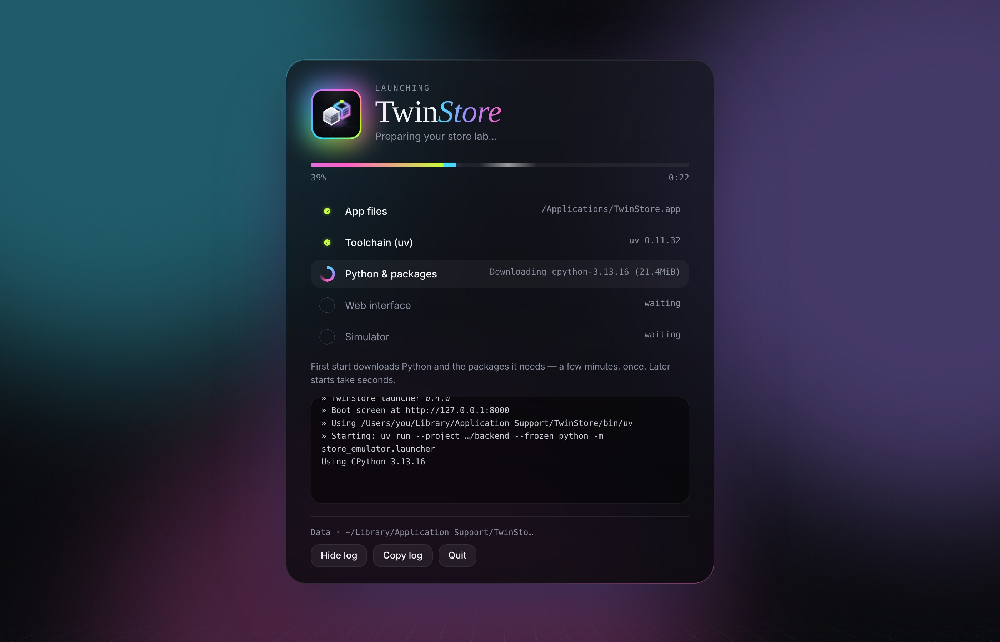</td>
<td>

| Computer | Download | Double-click |
| :-- | :-- | :-- |
| Windows 10/11 | `…-windows-x64.zip` | **TwinStore.exe** |
| macOS 11+ | `…-macos.zip` | **TwinStore.app** |
| Linux x64 / arm64 | `…-linux-*.tar.gz` | **twinstore** |

Clicking the icon again reopens the running app. Quit with
<kbd>⌘K</kbd> / <kbd>Ctrl K</kbd> → **Quit TwinStore**.
First-time security prompts and details: [`QUICKSTART.md`](./QUICKSTART.md).

</td>
</tr>
</table>

No API key is needed to start: the sample store runs with the rule-based engine, and without a key TwinStore can run a
small vision model on your own computer. Add an OpenAI, Anthropic, Gemini, Qwen or OpenRouter key — or any
OpenAI-compatible server such as vLLM, Ollama or llama.cpp — under **Models** for language and vision shoppers.

## Watch it run

<table>
<tr>
<td width="50%"><a href="./.github/assets/twinstore/twinstore-promo.mp4">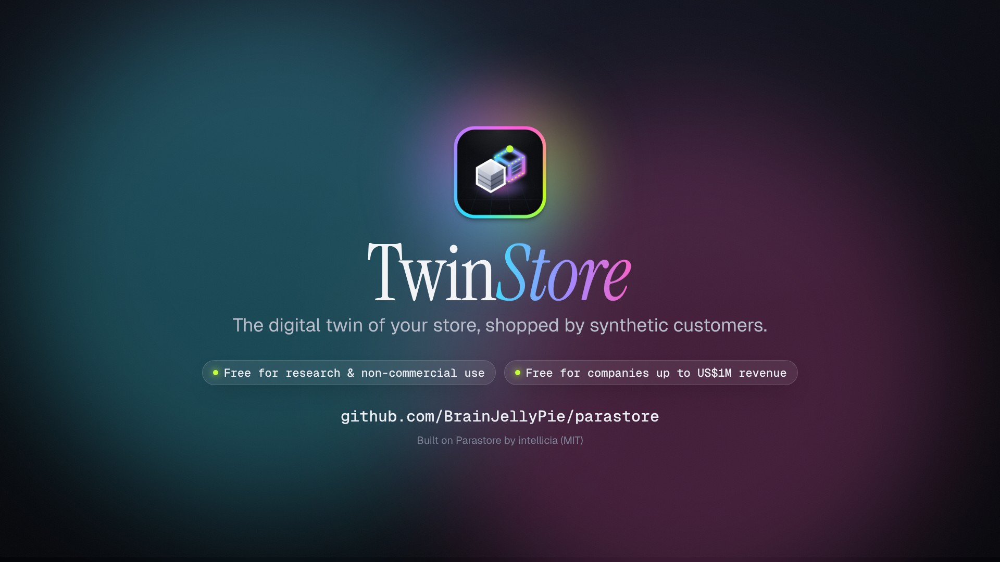</a><br>
<b>The film</b> · 55 s · what TwinStore is, in motion (<a href="./.github/assets/twinstore/twinstore-promo.mp4">MP4</a>)</td>
<td width="50%"><a href="./.github/assets/twinstore/twinstore-demo.mp4">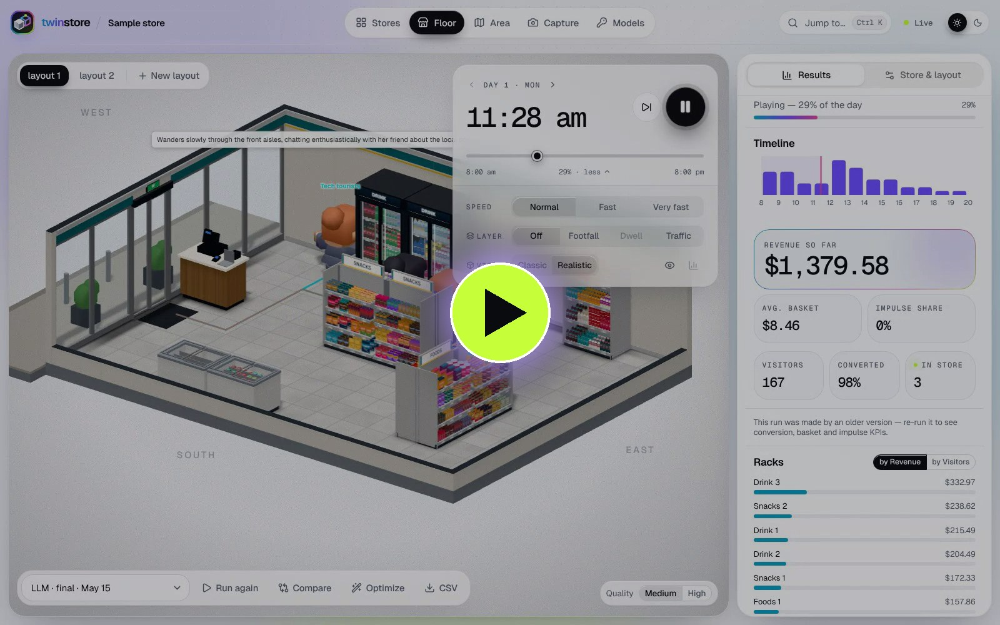</a><br>
<b>The app, running</b> · 75 s real recording: home, ⌘K palette, 3D playback, heatmap, shopper's eye, one shopper's journey, marketing studio, conjoint, shelf capture, neighborhood, night theme (<a href="./.github/assets/twinstore/twinstore-demo.mp4">MP4</a>)</td>
</tr>
</table>

### Feature demos

Short real recordings of single features. Each preview loops; click it for the full-quality MP4.

<table>
<tr>
<td width="50%"><a href="./.github/assets/twinstore/demos/templates.mp4">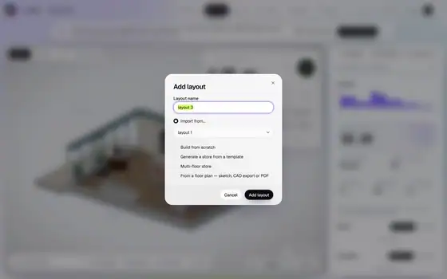</a><br>
<b>Start from a template</b> · 14 s · pick a store format, then a ready-made floor plan from the gallery (<a href="./.github/assets/twinstore/demos/templates.mp4">MP4</a>)</td>
<td width="50%"><a href="./.github/assets/twinstore/demos/situations.mp4">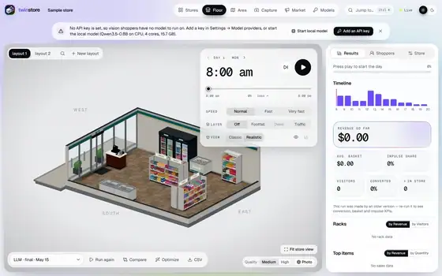</a><br>
<b>Set the scene</b> · 10 s · weekday, weather, holiday and neighborhood visitors before a run (<a href="./.github/assets/twinstore/demos/situations.mp4">MP4</a>)</td>
</tr>
<tr>
<td width="50%"><a href="./.github/assets/twinstore/demos/playback.mp4">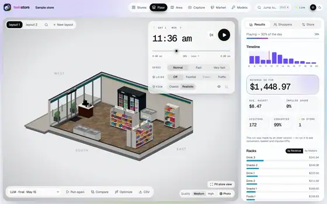</a><br>
<b>Watch the day</b> · 12 s · 3D playback with the clock, live sales and the heatmap (<a href="./.github/assets/twinstore/demos/playback.mp4">MP4</a>)</td>
<td width="50%"><a href="./.github/assets/twinstore/demos/shopper-eye.mp4">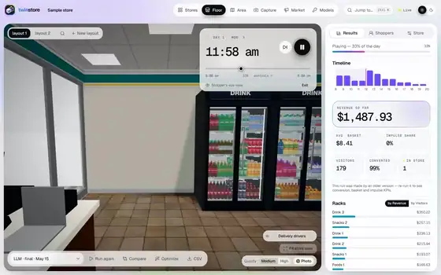</a><br>
<b>Shopper's eye</b> · 7 s · ride along at eye level as a shopper walks the aisles (<a href="./.github/assets/twinstore/demos/shopper-eye.mp4">MP4</a>)</td>
</tr>
<tr>
<td width="50%"><a href="./.github/assets/twinstore/demos/journey.mp4">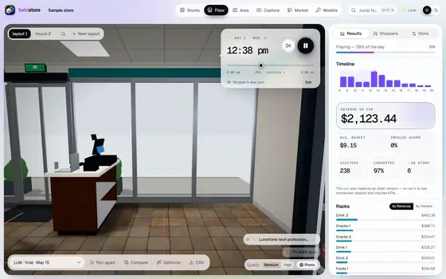</a><br>
<b>One shopper's journey</b> · 15 s · follow a single shopper: route, stops, what they saw and bought (<a href="./.github/assets/twinstore/demos/journey.mp4">MP4</a>)</td>
<td width="50%"><a href="./.github/assets/twinstore/demos/compare.mp4">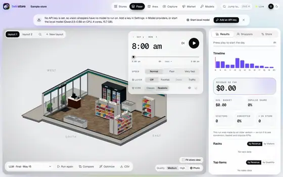</a><br>
<b>Compare two runs</b> · 13 s · the same shoppers in two layouts, side by side (<a href="./.github/assets/twinstore/demos/compare.mp4">MP4</a>)</td>
</tr>
<tr>
<td width="50%"><a href="./.github/assets/twinstore/demos/optimize.mp4">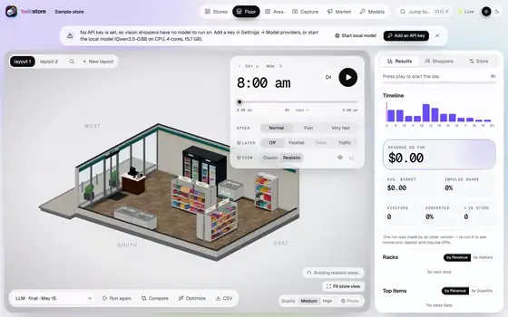</a><br>
<b>Optimize the layout</b> · 14 s · let TwinStore search for a better arrangement toward your goal (<a href="./.github/assets/twinstore/demos/optimize.mp4">MP4</a>)</td>
<td width="50%"><a href="./.github/assets/twinstore/demos/ab-test.mp4">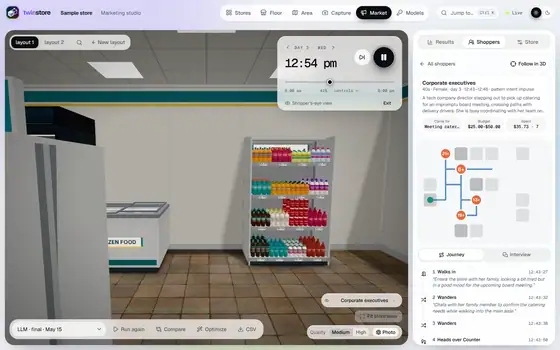</a><br>
<b>A/B test a price</b> · 8 s · a discount tested on paired shoppers, by segment (<a href="./.github/assets/twinstore/demos/ab-test.mp4">MP4</a>)</td>
</tr>
<tr>
<td width="50%"><a href="./.github/assets/twinstore/demos/conjoint.mp4">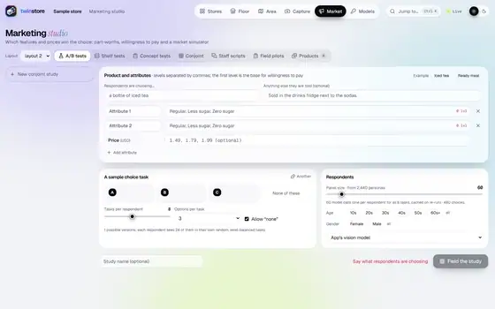</a><br>
<b>Conjoint study</b> · 8 s · design a choice study, run it, read part-worths and willingness to pay (<a href="./.github/assets/twinstore/demos/conjoint.mp4">MP4</a>)</td>
<td width="50%"><a href="./.github/assets/twinstore/demos/shelflab.mp4">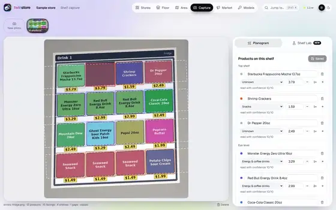</a><br>
<b>Shelf lab</b> · 8 s · lay out a shelf and generate new packs for it (<a href="./.github/assets/twinstore/demos/shelflab.mp4">MP4</a>)</td>
</tr>
<tr>
<td width="50%"><a href="./.github/assets/twinstore/demos/shelftest.mp4">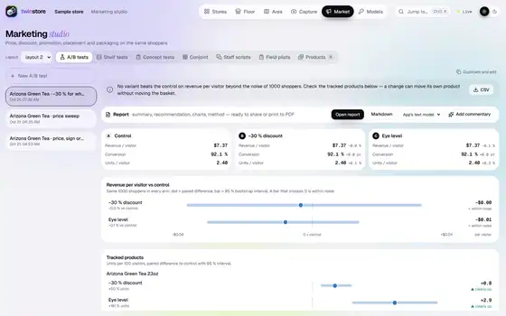</a><br>
<b>Shelf test</b> · 9 s · place a new pack on the shelf and see whether shoppers notice it (<a href="./.github/assets/twinstore/demos/shelftest.mp4">MP4</a>)</td>
<td width="50%"><a href="./.github/assets/twinstore/demos/neighborhood.mp4">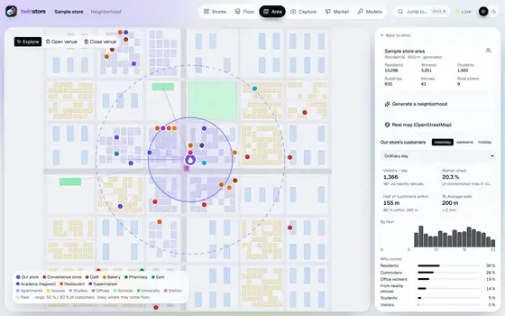</a><br>
<b>The neighborhood</b> · 6 s · the store in its catchment: homes, rivals and who walks in (<a href="./.github/assets/twinstore/demos/neighborhood.mp4">MP4</a>)</td>
</tr>
</table>

The language control next to the theme switch supports **English, 한국어, 中文, 日本語,
Español and Français**. It follows your browser language on first use and remembers your
selection. Home, navigation, store cards, search, the model notice and the simulation launcher are localized.
The detailed situation and model editors, other feature editors and technical server messages
currently remain in English.

## What you can do

<table>
<tr>
<td width="50%">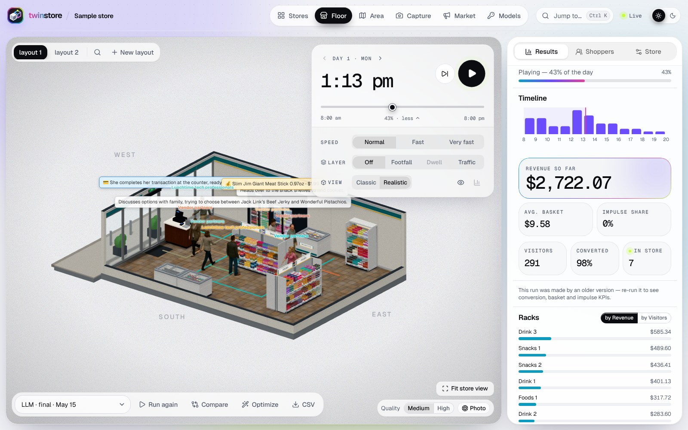<br>
<b>Photoreal 3D twin.</b> Photographic shoppers walk the floor on a wall-clock day; scrub, pause, speed up, follow anyone. <b>Photo</b> path-traces any view into a still.</td>
<td width="50%">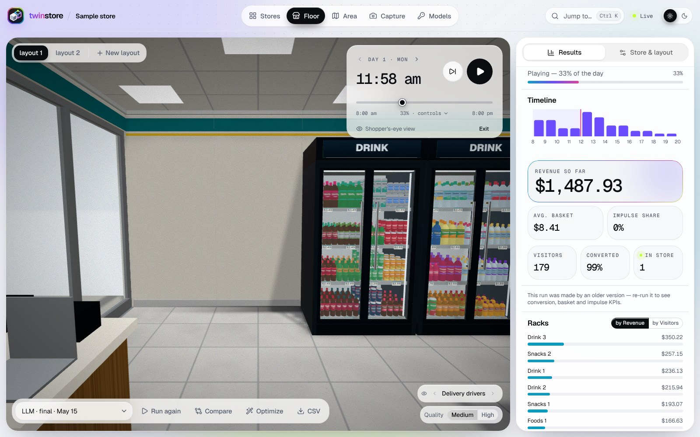<br>
<b>Shopper's-eye view.</b> The first-person camera shows what a shopper — and the vision model — sees.</td>
</tr>
<tr>
<td>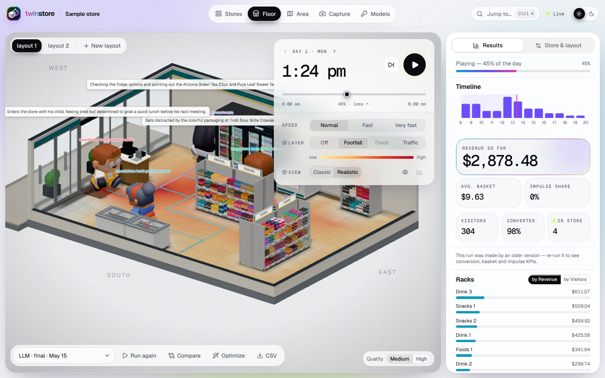<br>
<b>Heat, dwell and traffic.</b> Footfall, dwell and predicted-traffic layers, rack KPIs in 3D, revenue by rack.</td>
<td>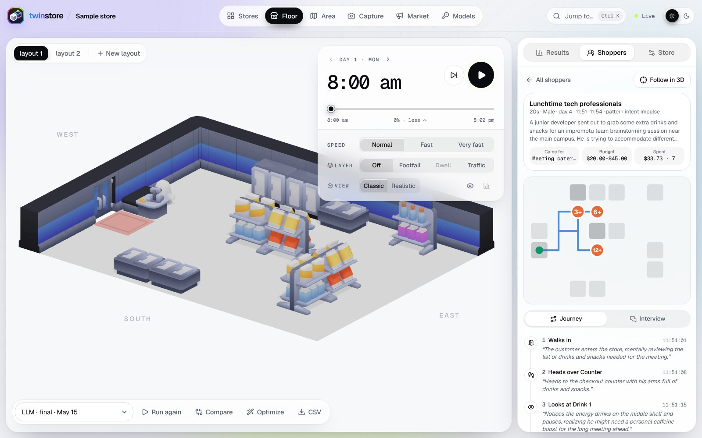<br>
<b>Follow one shopper, then ask why.</b> Their path, stops, the shelf they saw and their thoughts step by step; interview them afterwards, alone or as a group.</td>
</tr>
<tr>
<td>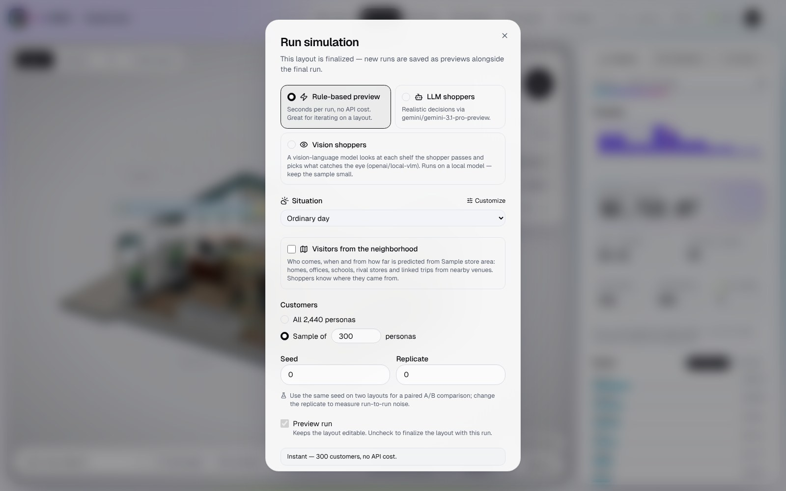<br>
<b>Run a day.</b> Rule, language or vision shoppers; one model or an ensemble; 19 situations from a rainy Monday to a big match.</td>
<td>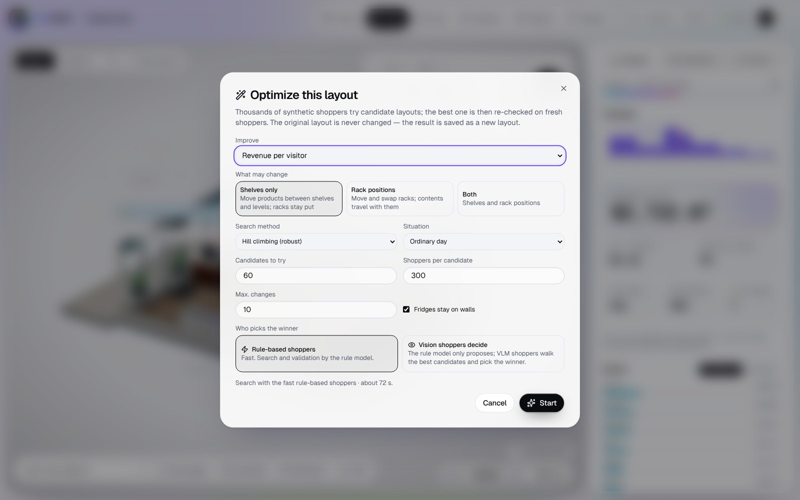<br>
<b>Optimize the layout.</b> Search shelf placements or rack positions for revenue, conversion or shorter walks, judged by vision shoppers.</td>
</tr>
<tr>
<td>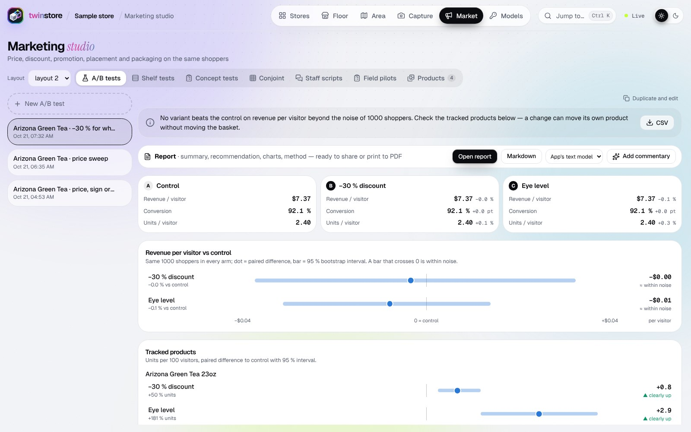<br>
<b>A/B tests for marketers.</b> Price, discount, promotion sign, placement or a new pack, on the same shoppers; lifts with 95 % CIs, by segment, with a report.</td>
<td>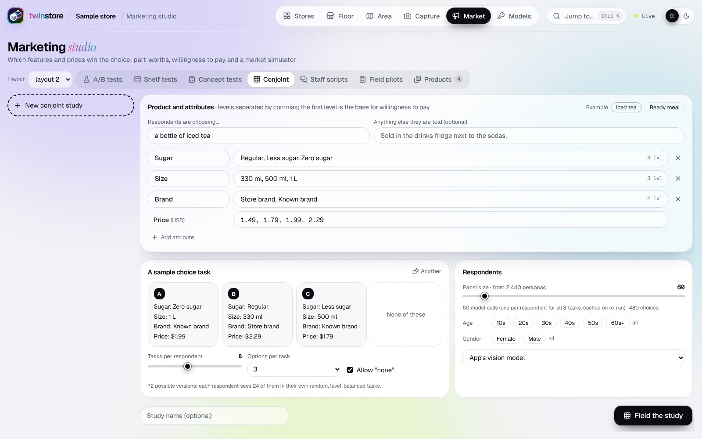<br>
<b>Conjoint studies.</b> Which features and prices win the choice: part-worths, importance, willingness to pay and a market simulator.</td>
</tr>
<tr>
<td>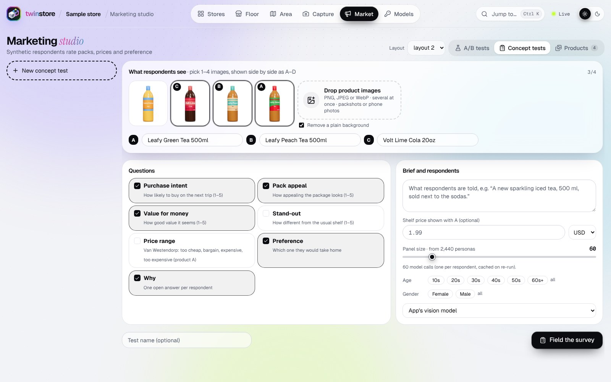<br>
<b>Concept tests.</b> Drop pack images; personas rate intent, appeal, value, price range and preference.</td>
<td>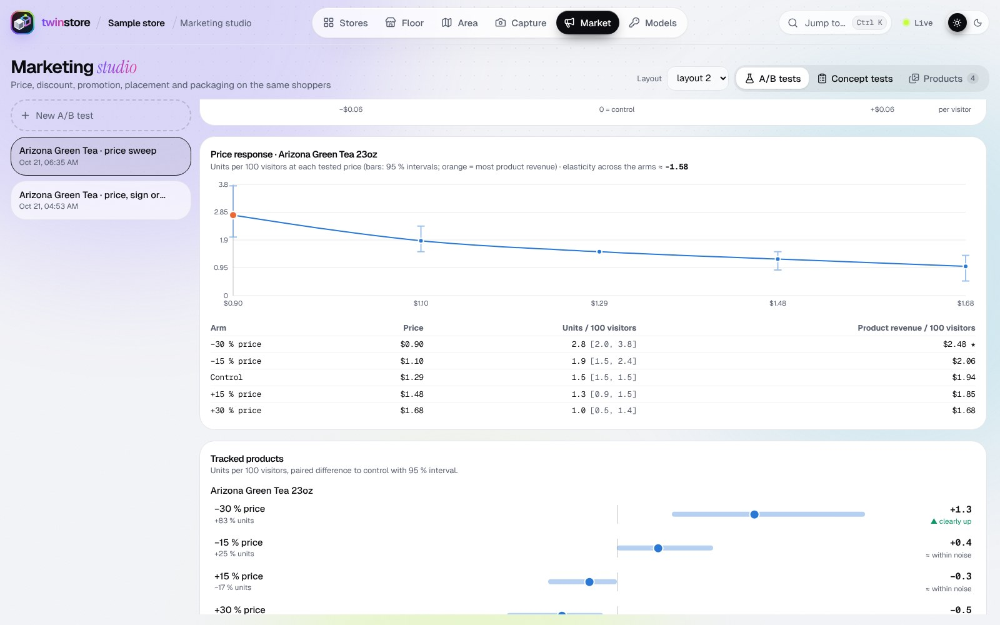<br>
<b>Price sweeps.</b> A product at five prices on the same shoppers: demand curve, elasticity, revenue-maximising price.</td>
</tr>
<tr>
<td>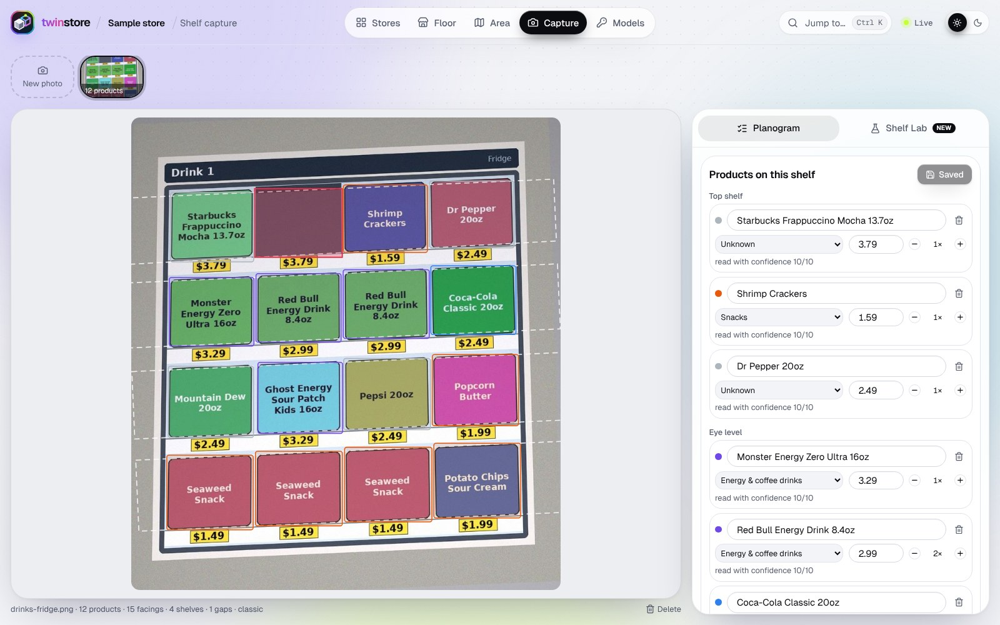<br>
<b>Shelf capture &amp; Shelf Lab.</b> A phone photo becomes a planogram; edit it counterfactually, audit it and plan the restock.</td>
<td>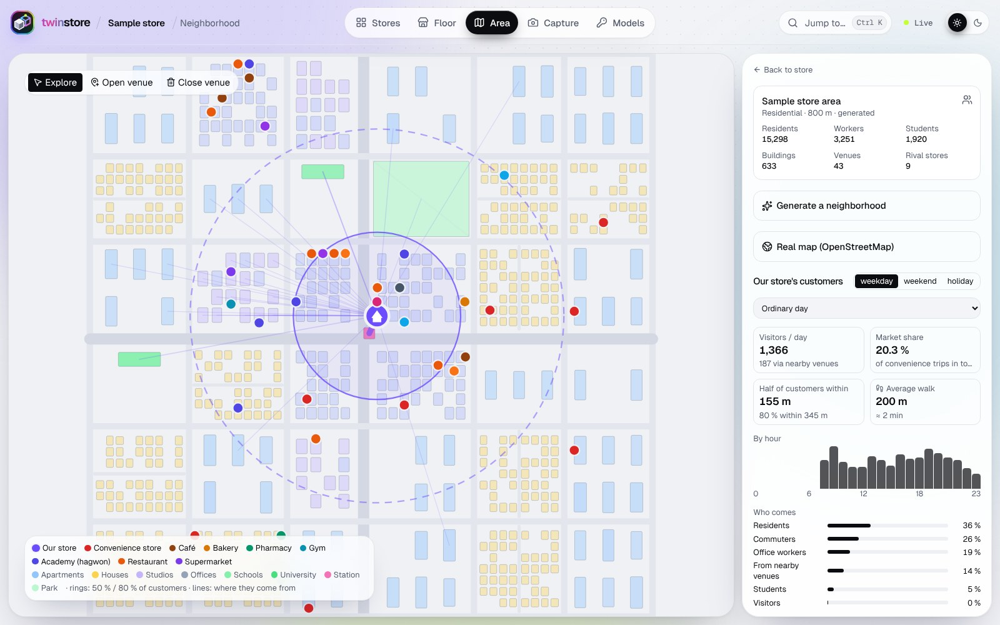<br>
<b>The neighborhood.</b> Generated or OpenStreetMap towns, Huff demand, rival stores, synergy with the shop next door.</td>
</tr>
<tr>
<td>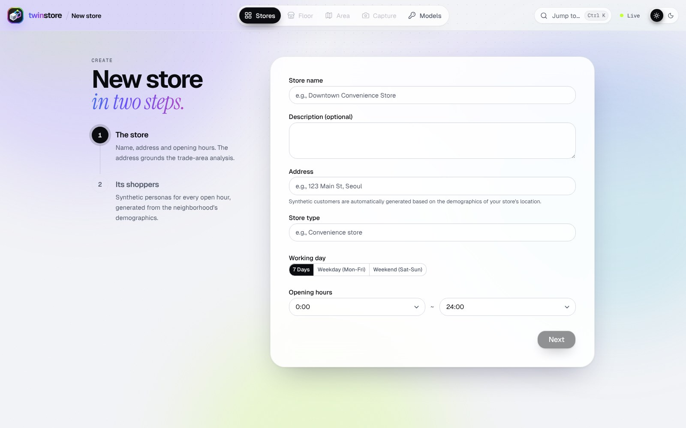<br>
<b>New store in two steps.</b> Store details, address, hours and one of 60 furnished starting layouts — or a floor-plan image.</td>
<td>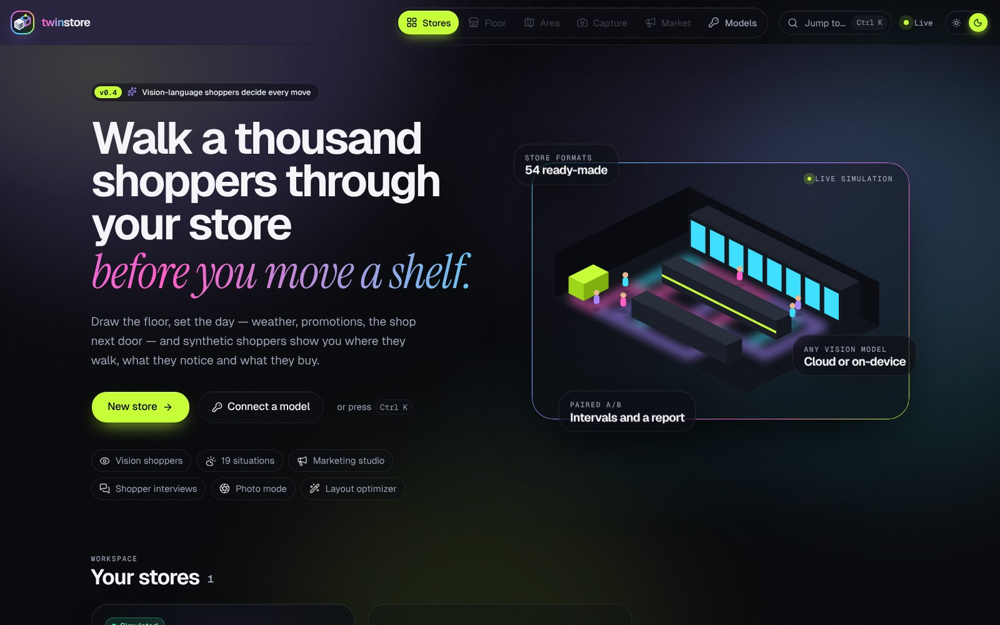<br>
<b>Day and night.</b> A command bar, <kbd>⌘K</kbd> palette for everything, quick links on every store, light and dark themes.</td>
</tr>
</table>

## Simulate, compare, optimize

The **Floor** page is the store's day. Press **Run simulation** and choose:

- **Who shops.** The rule-based engine (seconds, no model), language-model shoppers that plan, intend and give in to
  impulses, or vision shoppers that look at rendered shelves — deciding everything, or only judging what they glance at.
- **Which model.** The server default, one model, or an ensemble that mixes models across shoppers or lets them vote —
  for example one model from each provider. The dialog estimates the number of model calls before you start.
- **What kind of day.** One of **19 situations** — weather, temperature, weekday or holiday, crowding, local events,
  promotions, sold-out items and notes for the model shoppers — or your own. Customer sample, seed and
  preview-or-final run are set in the same place. The dialog opens with the engine and customer sample; expand
  **Advanced settings** for situations, models, neighborhood visitors, seed, replicate and finalization. Vision
  runs start with at most 30 customers, and language-model runs with at most 300; the call estimate stays visible.

**Results** fill in as the day plays: revenue, conversion, basket, footfall and dwell heatmaps, revenue by rack, what
caught the vision shoppers' eye and at which shelf level, who walked in at the door, and run diagnostics (failed
customers, dropped over-budget or hallucinated buys, cost). Export every customer as CSV, validate a run against your
POS export (CSV or XLSX) or receipts, and compare observed movement tracks with simulated occupancy.

Run selection, comparison and exports sit below the store view. On phones and small tablets, playback controls
start folded with Play/Pause and the time slider still available; expand them for speed, heatmaps and graphics.

- **Compare runs** — any two runs side by side on paired customers: a forest plot of differences with bootstrap 95 %
  intervals, P(B > A) and how many customers you would need to detect a 5 % change.
- **Optimize** — pick a goal (revenue, conversion, units, impulse revenue or shorter walks), what may change (shelves,
  rack positions or both), a search method (hill climbing, simulated annealing or a genetic algorithm) and a situation.
  A rule model calibrated to the vision shoppers searches; an optional panel of vision shoppers judges the finalists
  with P(better). The winner is saved as a new layout.
- **Layouts** — alternatives of a store live side by side as tabs; download the planogram as an Excel workbook, edit it
  and upload it back.

### Shoppers and interviews

During playback the **Shoppers** tab lists everyone who came — sorted by top spenders, those who left empty-handed,
impulse buyers or the longest visits. Open one to see their path, every stop, the shelf face they saw there and what
they thought; **Follow in 3D** jumps to their arrival and keeps the camera on them. Then ask them anything ("why didn't
you buy anything at the snack shelf?"): answers come from their persona and trip only and point at the steps they mean.
A **group interview** asks a segment (say, everyone who left empty-handed; 4–40 shoppers) one question and codes the
answers into themes.

### Photo mode

**Photo** path-traces the current view (three-gpu-pathtracer) into a photoreal still with global illumination,
area-light shadows, glossy floors, glass and HDR store lighting. Choose 64, 256 or 1,024 samples, denoise, and depth of
field (f/1.4–5.6) in the shopper's view; save it as PNG.

### Store formats and templates

Start from **60 furnished formats** — convenience stores, supermarkets, hypermarkets and warehouse clubs, pharmacies,
cafés, bakeries, pizzerias, sushi, ramen, Korean, burger, salad and ice-cream shops, fashion, footwear, eyewear,
jewelry, music, bookstores, electronics, pet, garden and craft stores — each with its own assortment, palette, seating
and checkouts, or from **14 multi-floor buildings** (department store, dining house, campus hub and more). Choose which
product categories to stock, where the entrance, exit and checkouts go, how many dining tables, aisle widths, shelf
direction and areas to keep clear; compare against the format default and download the plan as SVG. Every option and
the floor editor (up to 40×40 cells) are documented in [`STORE_TEMPLATES.md`](./STORE_TEMPLATES.md).

### The neighborhood

**Area** puts the store in a town: generate one (residential, university, station, suburban, tourist or mixed, at a
chosen density) or import streets and venues from OpenStreetMap. A Huff demand model gives visitors per day, market
share, catchment, average walk, visitors by hour and who comes; open or close a venue to see what changes, and let
simulation runs draw their visitors from the town. A storefront photo sets how strongly the store pulls, a rival's shelf
photo sets its price index, and a vision check rates the synergy with the shop next door.

## Marketing studio

For brand managers, category teams, store operators and research agencies (**Market** in the command bar). Eight tabs:

- **A/B tests** — a variant is a list of changes to a saved layout: a new price, a discount with the was-price on the
  tag, a promotion sign (1+1, SALE, −30 %), a move to eye level or another fixture, a new pack, or a category re-price
  with .99 endings. One-click recipes: discount ladder, discount vs sign, eye level vs bottom shelf, **price sweep**
  (a demand curve with the product's elasticity and revenue-maximising price), price up, new pack.
  Every arm runs on the **same shoppers with the same random numbers** as the control, so the result reports paired
  differences with bootstrap 95 % intervals — revenue, conversion and units per visitor, and units, spend and buyers of
  each tracked product — **by age group and gender**, and names a winner only when its interval clears zero. Rule
  shoppers answer in seconds; vision shoppers also see packs and signs. Every finished test comes with a **report** —
  summary and recommendation, design, charts, tracked products, method, and optional model-written commentary — as a
  print-ready page (PDF) or Markdown.
- **Shelf tests** — the classic shelf impact test: the same respondents see the shelf as it is and with a new pack,
  price or sign (previewed live), pick what they would take and say what caught their eye first; pick share and
  stand-out are compared pair by pair.
- **Concept tests** — up to four images side by side; a vision model answers as each sampled persona (with age and
  gender quotas): purchase intent, pack appeal, value, stand-out (1–5), a Van Westendorp price range, preference and
  one open answer. Results show distributions, means with CIs, top-2-box, Wilson intervals for preference, the price
  curves with the acceptable range, segment tables and verbatims; respondent-level CSV export.
- **Conjoint** — choice-based conjoint: define a product's attributes and levels (pack size, sugar, brand, claim …) and
  price levels. Each respondent gets their own level-balanced choice tasks (2–4 versions plus "none") and answers them
  in one model call. A multinomial logit gives **part-worths**, **attribute importance** and **willingness to pay**,
  with intervals that resample respondents, importance by segment, and a **market simulator**: build a line-up from the
  tested levels, move a price slider and watch the shares of preference — and the share-versus-price curve — update.
  Long-format CSV for re-estimation elsewhere.
- **Staff scripts** — compare two exact greetings, recommendations or objection-handling lines on the same
  synthetic shoppers, with independent exposures and balanced request order. Hold the product, price and encounter
  context fixed; compare purchase intent, trust and pressure (1–5), paired bootstrap intervals, exploratory segments
  and customer replies. Results screen wording for a field pilot; they do not estimate real conversion or sales.
- **Field pilots** — turn a staff-script test into a fixed, balanced A/B assignment sheet within anonymous staff/shift
  blocks; plan sample size and duration from your minimum worthwhile difference and daily traffic; import observed
  encounters and purchases (with a reviewed change history), check collection gaps, and reconcile POS purchases to the
  assignments. A complete planned sample gets a conservative 95 % conversion-difference interval; missing
  transactions never become non-purchases.
  **Staff and shift sensitivity** checks completed, locked pilots by leaving out each staff alias, shift ID
  and staff/shift block in turn, with the original planned weights renormalized. It exports all deletion
  estimates and flags opposite signs without producing new hypothesis tests or staff performance rankings.
  **Staff-script cost scenario** applies explicit contribution, staff-time, hourly labor cost and traffic
  assumptions to the locked conversion result. It shows break-even lift and conditional contribution ranges,
  with CSV export; these are cost scenarios, not realized profit or daily sales forecasts.
  **Observed staff time** reviews an anonymous assignment/time CSV from a completed, locked pilot. It
  checks staff/shift coverage, withholds averages until all times are recorded, and exports a source-bound
  audit to inform explicit labor-cost assumptions without inferring profit or staff performance.
- **Inventory** — upload observed period stock, movements, net sales, COGS and inventory values at cost.
  Reconcile each SKU before interpreting net unit sell-through, period turnover and GMROI. Missing data are
  rejected; stock/value conflicts withhold ratios. Export source inputs, calculations and review flags with
  the period and source hash. These descriptive records do not estimate a promotion's causal effect or place orders.
- **Products** — drop packshots or phone photos of packs (the background is cut out), name them, tag the brand and link
  each to the shelf product it replaces. Shelf Lab and the vision shoppers use the same images.

Any finished A/B, shelf, concept or conjoint test can be **duplicated and edited** into the next one. Concept, shelf and
conjoint tests have print-ready reports too. Synthetic respondents are for screening and direction; calibrate against
a real panel before deciding.

## How it works

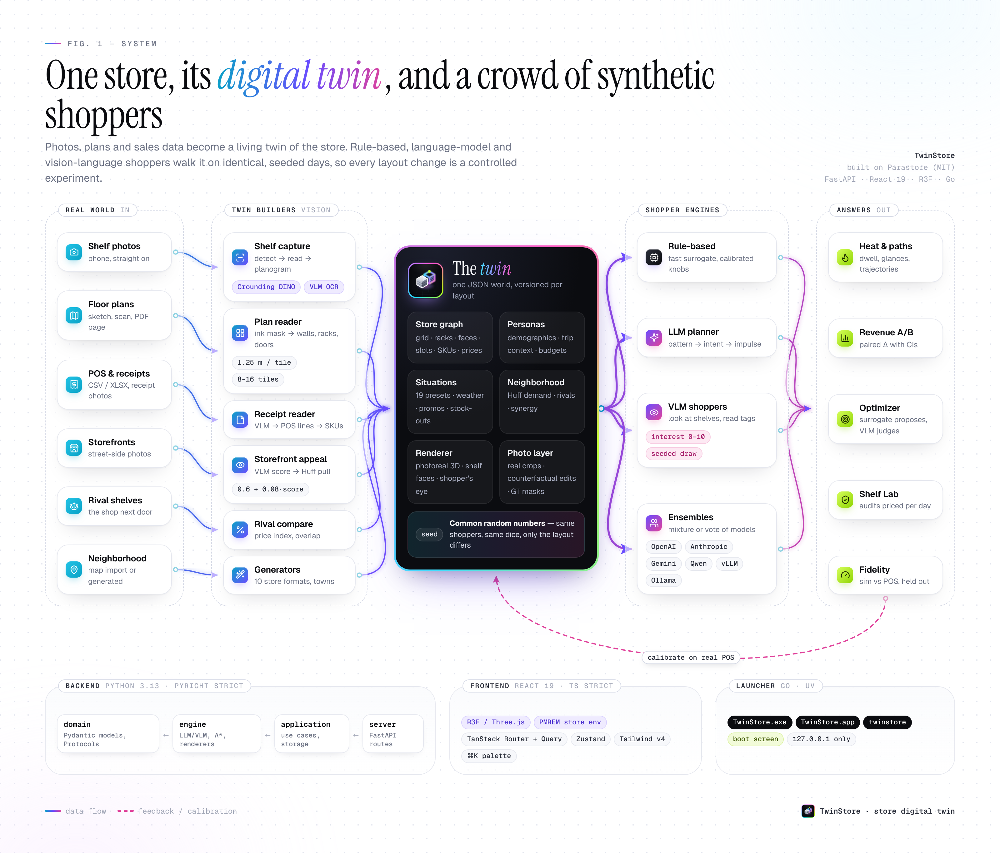

**Fig. 1 — System.** Photos, plans and sales data are turned into one JSON world per layout (store graph, personas,
situations, neighborhood, renderer, photo layer). Rule-based, LLM and VLM shoppers walk it on seeded days; results flow
back into calibration against real POS data.

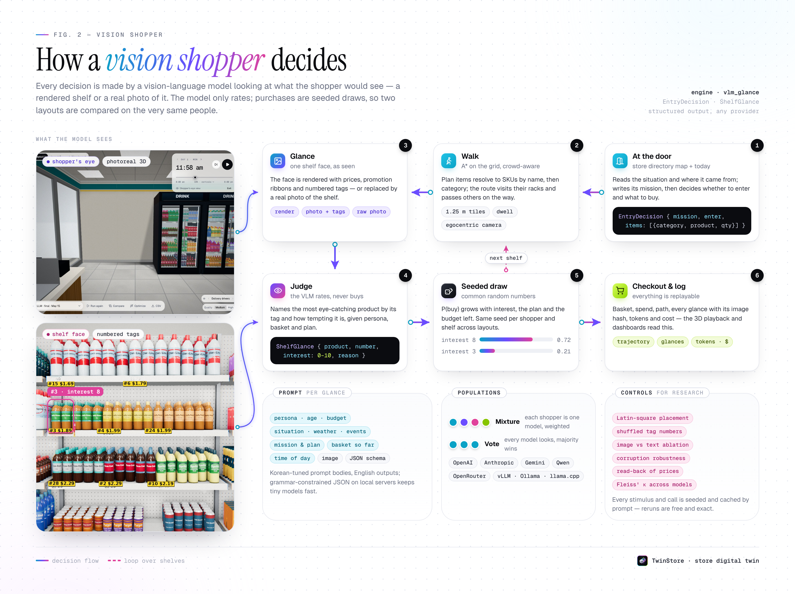

**Fig. 2 — Vision shopper.** At the door the model reads a directory map and today's situation and writes a plan
(`EntryDecision`); at each shelf it sees the face — rendered or photographed, with numbered tags — and rates the most
tempting product 0–10 (`ShelfGlance`). The purchase is a seeded draw from that rating, so a model's eagerness cannot set
the purchase rate, and paired layouts share every random number.

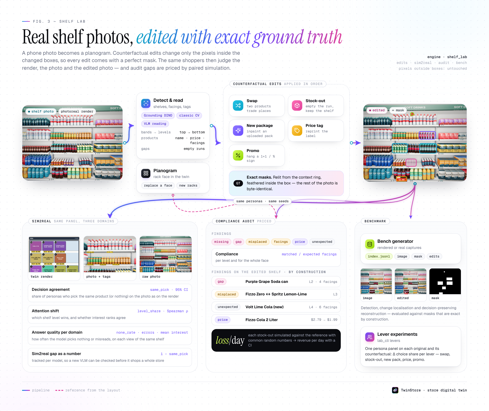

**Fig. 3 — Shelf Lab.** Swap products, empty a run, inpaint a new package, reprint a price tag or hang a promotion on a
real shelf photo. Only pixels inside the changed boxes move, so every edit has an exact mask. The same shoppers judge
the render, the tagged photo and the raw photo (sim2real agreement with CIs, with each panel's picks painted onto the
photo), and compliance gaps against the reference layout are priced in revenue per day by paired simulation. The shelf
here is a photoreal render from the built-in shelf studio, which supplies exact boxes; phone photos are edited the same
way. Details: [`SHELF_LAB.md`](./SHELF_LAB.md).

Completed audits also plan the restock. **Restocking priorities** ranks the missing products by net contribution over a
chosen horizon (margin and handling overhead), with **Locate** on the shelf and CSV export. **Restocking quantities
and budget** takes verified stockroom counts, required shelf units, supplier pack sizes and costs and priorities, and
prepares a budgeted worksheet in whole supplier packs, showing unfilled units and pack surplus — without deriving
inventory from a photo, placing orders or predicting recovered sales.

### Photos in, twin out

| Input | What TwinStore does with it |
| :-- | :-- |
| Shelf photo | detects shelves and facings, reads names and price tags → a rack face in the planogram |
| Floor-plan image or multi-page PDF | preview the selected page and rotation → ink mask or vision model → walls, racks, doors on an 8–16 tile grid; PDF support included |
| Storefront photo | a vision model rates sign, entrance, window and upkeep → the venue's pull in the neighborhood model |
| Receipt photos | transcribed by a vision model → review product matches, quantities and paid amounts → check and score a run against corrected POS lines |
| POS export with timestamps | sets when the simulated shoppers arrive (new-store wizard), and scores a run's sales |
| Anonymous track CSV | device-extracted grid coordinates → observed vs simulated visitor and occupancy heatmaps, tracking-gap accounting and per-cell differences; aggregate reports only |
| Rival's shelf photo | price index and assortment overlap against your layout → the rival's price-adjusted pull |

## Validated on real baskets

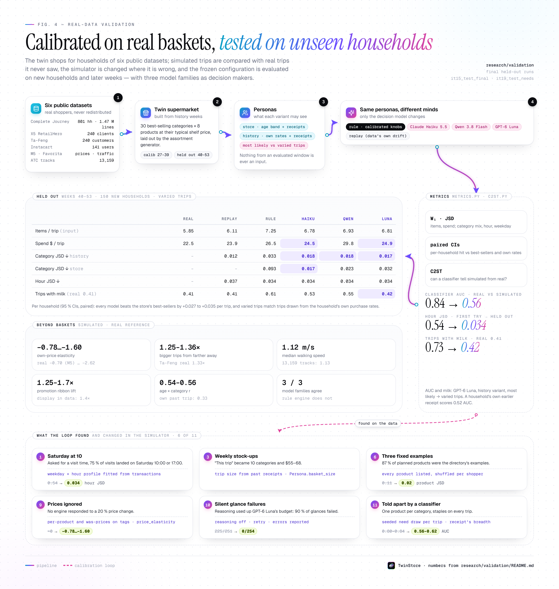

**Fig. 4 — Validation.** TwinStore's own engines shop for the households of public datasets, and the simulated
trips are compared with real trips they never saw. The main test uses dunnhumby's *The Complete Journey*: 150
households and 14 weeks, held out (replicated on a second panel), with Claude Haiku 5.5, Qwen 3.8 Flash and GPT-6
Luna as decision models, alone and mixed into one population. Every failure the data exposed changed the simulator:
- visit times and trip size;
- silent fallbacks;
- shelf prices and price response;
- walking speed and time at the shelf;
- trips that repeat the same staples, and habits within a category;
- situations (weekend, season, holidays, a big match, the time of day) from convenience-store guesses to effects
  measured on real receipts.

| Check (held out) | Simulated | Real reference |
| :--- | :--- | :--- |
| Category mix of the population (JSD) | `0.009–0.018` (two panels) | `0.006–0.012` (a household's own earlier receipts) |
| Per-household hit vs the store's best-sellers | `+0.027 to +0.035` (95 % CIs above 0) | – |
| Demographic differences in category mix, told only who the household is | `r 0.27` (p 0.006) | `0.30` (one own earlier receipt) |
| Repeat purchases (share of a trip's products bought before) | `0.56–0.72` | `0.73` |
| Classifier AUC, real vs simulated receipt | `0.55–0.62` | `0.46–0.52` (own earlier receipt vs later one) |
| Own-price elasticity | `−0.78 to −1.60` | `−0.70` (M5) to `−2.62` (meta-analysis) |
| Situation effects (weekend, match, seasons, holidays), correlation with real | `0.80–0.89` | ignoring them: error `0.109`, simulated `0.046–0.111` |
| Evening vs morning: beer, ice cream | `1.4–2.2×`, `1.3–1.8×` | `2.1×`, `1.9×` |
| Bigger trips from farther away (Ta-Feng) | `1.25–1.36×` | `1.33×` |
| Walking speed (13,159 tracks) | `1.12 m/s` | `1.13 m/s` |
| Seconds at the shelf per unplanned purchase (eye tracking) | `7–9` (median) | `8.2` |

The full validation study — what failed, what was fixed, its limits and how to reproduce it — is maintained outside
this repository; every number in it is recomputed from the saved trips.

## For researchers

Every stimulus and every model call is seeded and cached, so experiments are paired and reproducible, and figures
regenerate from saved JSON without model calls. The research directions TwinStore is built for:

- **VLM shopper bench** — position and order biases (Latin-square placement, shuffled tag numbers), merchandising
  levers, price read-back, persona and situation conditioning, corruption robustness, image-vs-text ablation, agreement
  across models (Fleiss' κ).
- **Shelf-to-planogram digital twins** — detection + VLM reading with exact ground truth, and *decision-preserving
  reconstruction*: does the simulator reach the same conclusion on the reconstruction as on the original?
- **Sim2real for shopper agents** — the same panel on renders, tagged photos and raw photos (Shelf Lab).
- **Expensive-oracle layout optimization** — a rule-based surrogate proposes, vision shoppers judge on a paired panel.
- **Synthetic respondents** — concept tests, shelf tests and choice-based conjoint on persona panels, with the
  respondent-level data exported for comparison with human panels.

`uv run python -m store_emulator.lab_cli bench` writes a counterfactual benchmark (`index.jsonl` with images, masks and
edits) from rendered shelves or real captures.

## For developers

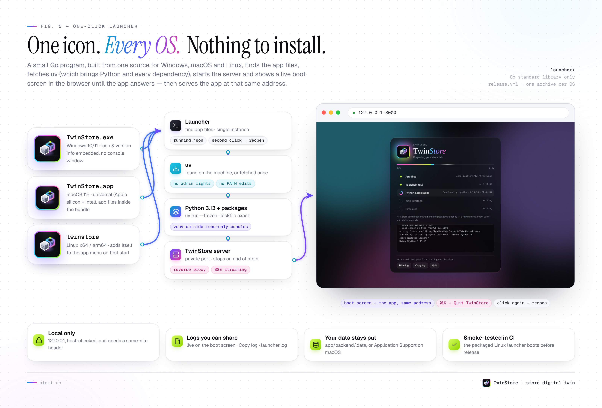

**Fig. 5 — Launcher.** One Go source builds `TwinStore.exe`, `TwinStore.app` and `twinstore`. It fetches uv if needed,
starts the server on a private port, shows the boot screen at `127.0.0.1:8000` and then proxies the app at that same
address. See [`launcher/README.md`](./launcher/README.md).

```bash
git clone https://github.com/BrainJellyPie/twinstore && cd twinstore
cp backend/.env.example backend/.env   # add an LLM API key if you want LLM shoppers — never commit real keys
./scripts/dev.sh                       # backend on :8000, frontend on :5173
```

Requirements: Python **3.13+** with [uv](https://github.com/astral-sh/uv), Node **20+** with **pnpm 10.33.0**. The
optional Grounding DINO detector for shelf capture: `cd backend && uv sync --extra capture` (pulls PyTorch).

<details>
<summary><b>Run each side, build, launcher</b></summary>

```bash
cd backend && uv sync && uv run uvicorn store_emulator.server.main:app --reload   # API docs at :8000/docs
cd frontend && pnpm install && pnpm dev                                          # VITE_API_URL=… to point elsewhere
cd frontend && pnpm build                                                         # the backend serves frontend/dist
launcher/build.sh                                                                 # TwinStore.exe / .app / linux → launcher/dist
```

Verification (keep all green): `uv run pyright src/`, `uv run pytest` in `backend`; `pnpm build`, `pnpm lint`,
`pnpm test` in `frontend`. Conventions for contributors and AI agents: [`AGENTS.md`](./AGENTS.md).

</details>

<details>
<summary><b>Headless experiments (CLI)</b></summary>

```bash
cd backend
# re-simulate a saved run's store + personas with the LLM-free engine, 3 replicates
uv run twinstore simulate --run sample_data/proj_67916afd/runs/run_ab0039 \
    --engine rule_based --replicates 3 --out /tmp/runs/A
# paired A/B of two layouts on the same personas (common random numbers)
uv run twinstore ab --store-a a.json --store-b b.json --personas personas.json \
    --engine rule_based --seed 1 --out /tmp/ab
uv run twinstore compare /tmp/ab/A/rep_0 /tmp/ab/B/rep_0   # any two run dirs
uv run twinstore fidelity /tmp/runs/A/rep_0 pos.csv        # Spearman, JS, NDCG vs POS
uv run twinstore summary /tmp/runs/A/rep_0
```

The former command name `parastore` still works. Everything in the app is also an HTTP API (`:8000/docs`), including
the marketing studio (`/api/projects/{pid}/experiments`, `/surveys`, `/shelf-tests`, `/conjoints`).

</details>

<details>
<summary><b>Vision shoppers without an API key (CPU or GPU, chosen automatically)</b></summary>

With no API key set, TwinStore says so in a notice under the command bar and runs its vision shoppers on a small open
model on your computer. It reads the hardware and picks the model:
- a GPU gets Qwen3.5-9B, 4B or 2B (CUDA on NVIDIA, Metal on Apple silicon, Vulkan on AMD/Intel);
- a CPU gets Qwen3.5-2B, 0.8B or LFM2.5-VL-450M, by cores and free memory.

It then downloads the matching [llama.cpp](https://github.com/ggml-org/llama.cpp) build and the model into
`.data/local_vlm/` and serves it on 127.0.0.1. Opened from the app icon this happens by itself; otherwise press
**Start local model** in the notice or on the Models page.

| Variable | Effect |
| :--- | :--- |
| `TWINSTORE_LOCAL_VLM=off` | turns it off |
| `TWINSTORE_LLAMA_SERVER=/path/to/llama-server` | uses your own build |
| `TWINSTORE_LOCAL_VLM_MODEL` | forces a model: `qwen3.5-0.8b`, `qwen3.5-2b`, … |

A llama.cpp server already running on port 8081 is used as it is. A cloud key gives faster and far more accurate
shoppers; the validation above uses cloud models.

To run the model by hand instead:

```bash
# Qwen3.5-0.8B (Q4_K_M) + its vision projector, ~1 GB RAM, 2 CPU threads
llama-server -m Qwen3.5-0.8B-Q4_K_M.gguf --mmproj mmproj-Qwen3.5-0.8B-F16.gguf \
    --port 8081 -c 8192 -np 1 --reasoning off --image-max-tokens 512 --cache-ram 256

cd backend
uv run twinstore simulate --run sample_data/proj_67916afd/runs/run_ab0039 \
    --engine vlm_glance --max-customers 30 --cache-dir .vlm_cache --out /tmp/runs/V
```

Measured on 2 vCPUs without a GPU (512 px shelf images, ~1.4 glances per customer):

| Model (Q4_K_M + F16 projector) | s / glance | Reads name / price of a numbered product |
| :--- | ---: | :--- |
| Qwen3.5-0.8B | ~9.5 | 58–63% / 50–69% |
| Qwen3.5-2B | ~22.5 | 88–94% / 100% |

Both favor products in the top row of a shelf image (2B: ~70% of picks) — treat VLM picks as a model to calibrate,
not as ground truth.

</details>

<details>
<summary><b>Models and providers</b></summary>

**Models** lists OpenAI, Anthropic, Gemini, Qwen and OpenRouter, plus any custom OpenAI-compatible endpoint (vLLM,
Ollama, llama.cpp, a gateway). Keys stay on your computer; each provider can be tested with one click and given its own
default model. Runs and the optimizer can use the app default, a specific model, or an ensemble; the marketing studio
uses the app default or a model you pick per test.

</details>

<details>
<summary><b>Configuration</b></summary>

Defaults live in `backend/src/store_emulator/application/config.py`; these environment variables override them (the
`PARASTORE_` prefix is kept for compatibility):

| Variable | Meaning |
| :--- | :--- |
| `PARASTORE_LLM_MODEL`, `PARASTORE_LLM_API_BASE` | LiteLLM model id and optional OpenAI-compatible endpoint |
| `PARASTORE_LLM_SEED`, `PARASTORE_LLM_CACHE_DIR` | per-call seed; on-disk response cache for repeatable LLM runs |
| `PARASTORE_LLM_TEMPERATURE`, `PARASTORE_LLM_MAX_TOKENS`, `PARASTORE_LLM_TIMEOUT_SEC` | sampling and limits |
| `PARASTORE_ENGINE` | default engine: `pattern_intent_impulse` (LLM), `rule_based` or `vlm_glance` (vision) |
| `PARASTORE_SEED`, `PARASTORE_CURRENCY` | default run seed; ISO 4217 currency of prices (e.g. `KRW`) |
| `PARASTORE_EXPOSURE_MODEL`, `PARASTORE_ROUTE_ORDERING` | `visibility`/`adjacency`; `planned`/`nearest` |
| `PARASTORE_BUDGET_TOLERANCE` | impulse-spend cap as a multiple of the persona budget (`none` disables) |
| `PARASTORE_VLM_MODEL`, `PARASTORE_VLM_API_BASE` | vision model for `vlm_glance` (default `openai/local-vlm` at `http://127.0.0.1:8081/v1`) |
| `PARASTORE_VLM_MAX_GLANCES`, `PARASTORE_VLM_GLANCE_POLICY`, `PARASTORE_VLM_LOOK_BASE` | shelves considered per customer; `gated`/`all`; look probability |
| `PARASTORE_VLM_IMAGE_WIDTH`, `PARASTORE_VLM_CACHE_DIR`, `PARASTORE_VLM_SEED` | shelf image width (px); response cache; per-call seeds |
| `PARASTORE_DATA_HOME` | for the launcher: folder that holds `.data` (projects, runs, settings) instead of `backend/` |

Running TwinStore with an AI assistant? Point it at [`USAGE.md`](./USAGE.md): the inputs a simulation hinges on, LLM
call counts per persona size, and the silent failures to catch before a run. History: [`CHANGELOG.md`](./CHANGELOG.md).

</details>

## Limitations

- **Calibrate before you trust numbers.** Out of the box the shoppers are plausible, not fitted to your store. Use the
  fidelity report against your POS data, read paired differences with their intervals, and see the validation loop for
  what calibration involves.
- **Synthetic respondents are not a panel.** Concept, shelf and conjoint results screen ideas; confirm with real people
  before pricing or launching on them.
- **Model calls cost money and time.** A week of personas for a modest store can be hundreds of calls (capped at 100
  personas per day by default, `PERSONA_DAILY_CAP`). The rule-based engine and response caches make iteration free.
- **One store at a time.** No fleet view or multi-week dynamics; crowding is light (per-shopper paths, no queues);
  floors of a building are simulated separately.
- **APIs and data shapes may still change** between versions.

## License

**TwinStore License 1.0** — see [`LICENSE`](./LICENSE).

| Who | Allowed |
| :-- | :-- |
| Research (academic or in a company, not in production) and non-commercial use | ✅ free, unlimited |
| Commercial use by individuals and organizations with annual revenue up to **US$1M** | ✅ free |
| Everyone else | 📩 separate license — [open an issue](https://github.com/BrainJellyPie/twinstore/issues) |

TwinStore is built on Parastore © 2026 intellicia, whose code remains available under the MIT License; its notice is
kept in full in [`LICENSE`](./LICENSE). Dependencies keep their own licenses
([`LICENSES-BACKEND.md`](./LICENSES-BACKEND.md), [`LICENSES-FRONTEND.txt`](./LICENSES-FRONTEND.txt)).

## Credits

- **Shoppers.** Realistic shoppers use locally bundled [Microsoft Rocketbox](https://github.com/microsoft/Microsoft-Rocketbox)
  avatars under MIT: ten appearances with textured faces and clothing, normal maps, varying surface roughness adapted
  from the original specular textures, separate face/body normal-map strengths for soft skin and clearer fabric
  detail, alpha-tested hair, authored eyelid blinks and small gaze shifts, and retargeted breathing, varied standing,
  walking and browsing animations. They pause with playback and keep adult proportions when highlighted. Sources and
  conversion instructions: [`frontend/public/assets/people/`](./frontend/public/assets/people/README.md).
- **Materials.** [Poly Haven](https://polyhaven.com/) CC0 material scans for ceramic flooring and wood fixtures (diffuse
  and roughness at every quality level; High adds OpenGL normal maps), [ambientCG Plaster 001](https://ambientcg.com/a/Plaster001)
  (CC0) for walls with consistent scale across lengths, corners and rotated sections, CC0
  [ambientCG Metal 032](https://ambientcg.com/a/Metal032) for exposed supports and frames in High, and Poly Haven's CC0
  Pavement 02 scan for the storefront pavement in High (world-space coordinates keep its 2.12 m coverage). Assets load
  locally with procedural fallbacks. High also uses ambientCG’s CC0 Office Ceiling 001 material for
  acoustic tiles, with matching color, roughness and normal maps; its tile grid and the Medium
  fallback align with ceiling lights at a consistent physical scale. Authors, source URLs and checksums are in
  [`frontend/public/assets/materials/`](./frontend/public/assets/materials/LICENSE.txt).
- **Props and products.** A reduced Poly Haven Potted Plant 01 model by Rico Cilliers (CC0) at the entrance in High
  ([`props/`](./frontend/public/assets/props/README.md)). Fresh bananas use Alexander Shulha's CC0 Poly Haven scan;
  single and paired apples and whole avocados use Oliver Harries' CC0 food scans; lemons use Kuutti Siitonen's CC0 scan, with shared instancing, two detail
  levels, photographic PBR maps and stable per-instance variation that is kept in Photo mode
  ([`produce/`](./frontend/public/assets/produce/README.md)). Garden-center terracotta pots use the hollow pot from Rico
  Cilliers' CC0 scan; plain croissants use Dario Barresi and Greg Zaal's CC0 Poly Haven scan; metal watering cans use
  Charles Nderitu's CC0 scan ([`products/`](./frontend/public/assets/products/README.md)).
- **Lighting.** High quality uses Poly Haven's [Gear Store HDR panorama](https://polyhaven.com/a/gear_store) for
  photographic indoor lighting and reflections, ambient occlusion that respects hair and leaf alpha masks and ignores
  transparent glass, and Three.js SMAA with 4× multisampling for hair, eyelashes and fine edges
  ([`environments/`](./frontend/public/assets/environments/LICENSE.txt)).
- **Your own photos.** Uploaded SKU photos and product crops from Capture appear on 3D packages (shared across facings;
  cylindrical packages use the central label band of the front photo, an approximation rather than a full scan).
  Playback fills missing photo references from the project's image library without rewriting recorded runs.
- **Classic view.** The original market, character and ghost assets are from [Kenney](https://kenney.nl), CC0 1.0 —
  [Mini Market](https://kenney.nl/assets/mini-market), [Mini Characters](https://kenney.nl/assets/mini-characters),
  [Graveyard Kit](https://kenney.nl/assets/graveyard-kit).
- **Data.** Validation uses dunnhumby *The Complete Journey* and *Breakfast at the Frat*, X5 RetailHero, Ta-Feng,
  Instacart, Favorita, M5, Rossmann, Walmart's sales in stormy weather, a supermarket eye-tracking study and the ATC
  pedestrian tracks; the capture benchmark's real-photo check uses ShelfWise "SKUs on shelves PL" (CC BY 4.0). None of
  these datasets are redistributed here.
- **Figures and films.** Generated from HTML in [`.github/assets/src`](./.github/assets/src) (`render.mjs`,
  `render-video.mjs`); the app recording is a scripted Playwright session of the real app.

## Contributing

Issues and pull requests are welcome. Please keep changes focused, run the verification commands above, and follow
[`AGENTS.md`](./AGENTS.md). For commercial licensing, open an issue and we will reach out.
